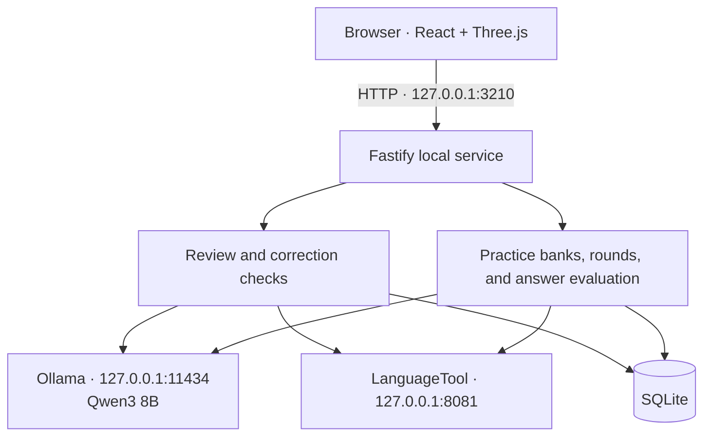

<p align="center">
  
</p>

<h1 align="center">MistakeQuest</h1>

<p align="center"><strong>Your English. Your mistakes. Another way to learn.</strong></p>

<p align="center">
  A local English writing companion that turns corrections from your own texts into optional minigames.
</p>

<p align="center">
  
  
  
  
</p>

<p align="center">
  <a href="docs/README.es.md">Español</a> ·
  <a href="#get-started">Get started</a> ·
  <a href="#six-ways-to-practice">The games</a> ·
  <a href="#architecture">Architecture</a> ·
  <a href="#development-and-tests">Development</a>
</p>


*The screenshots in this guide use sample writing and demonstration progress.*

MistakeQuest is a desktop-style app served in your browser. Write something in English, review the suggested corrections, and practice a specific mistake when you feel like playing. Ollama, Qwen3 8B, LanguageTool, and SQLite run on your computer; no account or cloud AI key is required.

The starting point is simple: **correct English should stay as it is**. Grammar review aims for small, necessary changes while preserving your meaning and vocabulary. Optional writing improvements are a separate action, and a text with no detected errors does not generate a game.

## What you can do

- **Review your own writing.** Check up to 6,000 characters using US or British English, with corrections, short explanations, and notices when a result is uncertain.
- **Learn from a concrete correction.** Choose among six optional games built from your error and additional short examples checked before use.
- **Return to what needs practice.** Saved rounds revisit mistakes, rotate examples across game formats, and keep your progress between visits.
- **See your learning history.** Track recurring writing errors, reviews, game attempts, completed games, race points, and XP. Writing errors and wrong game answers are counted separately.
- **Use Spanish or English controls.** Change the interface language without losing your draft or game. The English variant is an independent setting; exercises remain in English. Generated explanations currently use Spanish and are not automatically translated.
- **Control the atmosphere.** The Órbita interface combines a light editor, dark surroundings, and a Three.js scene. Pause visual motion, use the reduced-motion preference, or fall back to a static logo when WebGL is unavailable. Fonts, icons, and app assets are served locally.

## Get started

The included installation and launch scripts target **Windows x64**.

### Requirements

| Requirement | Why it is needed |
| --- | --- |
| Node.js **24 or newer**, with `npm` on `PATH` | Runs the service and builds the web interface; the database uses Node's built-in SQLite module. |
| Java **17 or newer**, with `java` on `PATH` | Runs the local LanguageTool server. |
| Internet for initial setup | Downloads npm dependencies, local engines, and the model. |
| Disk space and memory for a local 8B model | The default model download is roughly 5 GB. Engine files, download archives, and installed models require additional space. |

Local inference is resource intensive. A compatible GPU can reduce waiting time; CPU inference is possible but can be much slower. There is no verified universal RAM or GPU minimum for this project. The first review may take longer while the model loads, and longer passages can require several model calls.

### Install and launch

Open PowerShell in the location where you want the project:

```powershell
git clone https://github.com/yhonaMC/MistakeQuest.git
cd MistakeQuest
npm ci
npm run setup
& ".\Iniciar MistakeQuest.cmd"
```

Already downloaded the repository as a ZIP? Extract it, open PowerShell in that folder, and start with `npm ci`.

`npm run setup` runs [Install-Engines.ps1](scripts/Install-Engines.ps1). It installs portable **Ollama 0.40.4**, **LanguageTool 6.6**, and **`qwen3:8b`** under `%LOCALAPPDATA%\MistakeQuest`. Allow time for the first download. If the Ollama model pull fails, the installer can import the official Qwen GGUF instead. It verifies the Ollama archive and fallback model with SHA-256; the LanguageTool archive is checked against its expected size.

The launcher starts the engines in the background, starts the local service, and opens **[http://127.0.0.1:3210](http://127.0.0.1:3210)**. After setup, reviews and games can run without an internet connection. The model stays installed between sessions.

| Windows shortcut | Action |
| --- | --- |
| `Instalar motores.cmd` | Runs the same engine setup as `npm run setup`. |
| `Iniciar MistakeQuest.cmd` | Starts the local engines and app, then opens the browser. |
| `Detener MistakeQuest.cmd` | Stops processes started and tracked by these scripts. Keeps saved data and models. |

Closing the browser tab leaves the service and engines running. Use the stop shortcut when you want to shut them down.

> **Updating the app:** the launcher builds the web interface only when `dist/index.html` is missing. After pulling changes, stop the app, run `npm ci` and `npm run build`, then start it again so the updated interface is served.

## From writing to practice

1. **Write or paste a text.** Choose English US or UK and select **Review my text**.
2. **Inspect the result.** Your draft stays in the editor; corrections appear below it. Editing the draft or changing its English variant clears the previous result.
3. **Choose an error to practice.** Select **Practice this mistake**, then pick a game. Practice is always optional.
4. **Build a useful habit.** Return through **My progress**, resume a saved round, or practice a recurring error again.

The review pipeline combines an independent AI review with LanguageTool candidates, checks that edits match the original text, and filters optional style changes. Longer texts are reviewed in segments. Compound corrections are separated into smaller practice targets. Ambiguous cases can remain unchanged with an uncertainty notice.

Practice examples must reproduce a specific correction. LanguageTool or an independent AI review checks them before they enter the persistent example bank. Games prefer less-seen sentences across formats; if extra generation fails, already checked examples remain available. Historical corrections are checked again before practice: if a fragment was already correct, it is retired from recurring-error practice without creating a game or artificial XP.

**Suggest an improvement** is available only when requested. It may conclude that nothing needs changing and never replaces your draft automatically.

AI can still miss errors or suggest an incorrect change. These checks reduce that risk; they do not guarantee a perfect review. Ambiguous tense choices are deliberately left alone when the context does not justify a change.

## Six ways to practice

| Game | What you do |
| --- | --- |
| **Error radar** · Radar de errores | Find the word or fragment that needs changing in a 2D word shooting gallery. |
| **Word workshop** · Taller de palabras | Type the corrected fragment or the complete corrected sentence. |
| **Two paths** · Dos caminos | Steer a rocket through the gate containing the option that fits the sentence. |
| **Build the sentence** · Arma la frase | Arrange word tiles into a correct sentence. |
| **Connect pairs** · Conecta parejas | Match sentences with their corrections. |
| **Keep it or correct it?** · ¿Se queda o se corrige? | Decide whether a sentence needs a change, including recognizing valid English. |

### Two paths: ten gates, then a choice to continue


Each round has **10 gates**. Use **← / →**, **A / D**, or the on-screen controls to select a lane. Cross with **Space**, the button, or by reaching the gate. The rocket keeps flying between gates; a summary appears after the tenth.

- Each gate normally allows **5 seconds**. Six or more wrong or missed gates give you **8 seconds** per gate in the next round.
- A correct choice gives **100 race points**; a wrong choice gives **0**; making no choice gives **−10**.
- Later rounds bring back failed targets, using different sentences when available, and mix them with new challenges. For example, with enough content, **5 failed targets + 5 new challenges** fill the next round. Three failed targets can become three reviews, two earlier reviews, and five new challenges.
- When new content runs out, the interface labels the remaining exercises as **verified practice**.
- Every gate result and round plan is saved. Resume an unfinished round from **My progress**. Pausing stops the timer as well as the flight; disabling visual motion keeps the timed challenge available.

### Error radar: three sentences, three attempts each


A radar session contains **3 sentences**, each with **3 attempts**. The first and second wrong targets reveal progressively stronger hints. A third wrong target shows the correction and explanation before the next sentence. Shooting the background or selecting a discarded target does not consume another attempt.

Use the mouse, touch a word, or aim with **Tab / arrow keys** and activate with **Enter**. Pause to read the correction at your own pace. The summary distinguishes answers found without help, answers found with hints, and corrections revealed after attempts ran out.

The next session prioritizes targets that exhausted their attempts or needed hints, then fills remaining slots with new checked exercises when available. Returning targets use a different simple sentence when one is available. Resuming a partial session preserves its remaining attempts, discarded words, and current hint.

### XP rewards

| Successful completion | XP |
| --- | ---: |
| Without help | 20 |
| With a hint | 10 |
| After revealing the answer, where available | 5 |

An exhausted radar exercise or a wrong/missed race gate awards no XP. Repeating an already rewarded exercise does not award XP again. Rewards and attempts are evaluated and persisted by the server; race points are a separate score.

## Data and privacy

MistakeQuest has no user accounts or cloud AI integration. The browser talks to the local app, which uses the local engines. The provided scripts bind Ollama to loopback, and the app listens only on `127.0.0.1`. Keep these services local; the project is not configured as a public or multiuser web service.

| Data | Default location |
| --- | --- |
| SQLite history and progress | `%LOCALAPPDATA%\MistakeQuest\data\mistakequest.sqlite` |
| Model files | `%LOCALAPPDATA%\MistakeQuest\models` |
| Portable engines | `%LOCALAPPDATA%\MistakeQuest\runtime` |
| Startup and engine logs | `%LOCALAPPDATA%\MistakeQuest\logs` |
| Setup downloads | `%LOCALAPPDATA%\MistakeQuest\downloads` |

- **Full texts are not stored by default.** Corrections, explanations, and the sentence context needed for practice are stored, so the database can still contain personal writing. Enable **Save my full texts** in Settings to retain full texts for future reviews.
- Reviewing the exact same text and English variant on the same local calendar day reuses a completed review and avoids duplicate statistics. A later day can create a new review; uncertain results may be retried.
- Export your history as JSON from Settings or My progress. Settings can delete reviews, errors, games, and XP after you type **`BORRAR`**; installed engines and models remain.
- Interface language and motion preferences are saved in the browser. Learning history lives in SQLite.
- App service logging does not record review text. Exported data and the database should be treated as personal data.

Initial setup contacts external package and model hosts. Runtime app assets, fonts, and icons are local; no CDN is needed to use the interface.

## Architecture



Vite builds the interface into `dist/`; Fastify serves that output and the API from the same origin. Review and practice services share the local engines. SQLite stores settings, reviews, correction context, checked example banks, games, round plans, attempts, and idempotent rewards.

```text
MistakeQuest/
├── service/           # Local API, review pipeline, games, and SQLite storage
│   ├── app.js         # Routes and request guards
│   ├── review.js      # Review orchestration and edit validation
│   ├── games.js       # Example verification and game evaluation
│   ├── practice-*.js  # Example rotation and persistent round plans
│   └── store.js       # SQLite persistence and rewards
├── web/               # React editor, games, progress, settings, and i18n
├── public/assets/     # Logo, icons, and locally served fonts
├── scripts/           # Windows engine install, start, and stop scripts
├── tests/             # Unit, API, live-engine, and browser checks
└── docs/              # Spanish documentation and screenshots
```

### Configuration

The service reads these environment variables directly; it does not load an `.env` file:

| Variable | Default | Purpose |
| --- | --- | --- |
| `MQ_PORT` | `3210` | Local app HTTP port. |
| `MQ_DATA_DIR` | `%LOCALAPPDATA%\MistakeQuest` on Windows | Root for the database and app data. |

For a separate development instance, build the interface and start the service directly:

```powershell
npm run build
$env:MQ_PORT = "3215"
$env:MQ_DATA_DIR = Join-Path $PWD ".runtime\development"
npm start
```

The local engines must already be running. The Windows launcher sets its own `MQ_PORT=3210` and LocalAppData data directory, so use `npm start` for custom values. Engine endpoints are fixed in [service/config.js](service/config.js). Settings can select an installed local model; the provided setup and launcher expect `qwen3:8b` to be installed.

### Local API

| Method | Route | Purpose |
| --- | --- | --- |
| `GET` | `/api/health` | App, database, engine, and model readiness. |
| `GET`, `PATCH` | `/api/settings` | Read or update `locale`, `model`, and `saveTexts`. |
| `POST` | `/api/analyze` | Review `{ "text": "...", "locale": "en-US" }`. |
| `POST` | `/api/improvements` | Request an optional improvement using the same input. |
| `GET` | `/api/modes` | List the six game modes. |
| `POST` | `/api/games` | Create a game using an `issueId` and `mode`. |
| `GET` | `/api/games/:id` | Read public game state. |
| `POST` | `/api/games/:id/attempt` | Submit an answer and an `idempotencyKey`. |
| `POST` | `/api/games/:id/hint`, `/api/games/:id/reveal` | Request available assistance. |
| `POST` | `/api/practice-rounds` | Create a `choice` or `radar` round with an `issueId` and UUID `idempotencyKey`. |
| `GET` | `/api/practice-rounds/:id` | Read a saved round. |
| `POST` | `/api/practice-rounds/:id/next` | Advance after a completed `afterGameId`. |
| `GET` | `/api/progress`, `/api/export` | Read progress or export saved data. |
| `DELETE` | `/api/data` | Clear learning data with `{ "confirmation": "BORRAR" }`. |

API writes require **`Content-Type: application/json`** and **`X-MistakeQuest: 1`**. Requests accept local `Host` values only; a supplied `Origin` must match the app origin. These guards support local browser use, not remote authentication.

Inputs are validated with Zod. Text length is **1–6,000 characters**, supported locales are **`en-US` / `en-GB`**, and the HTTP body limit is **65,536 bytes**. Answer strings are limited to **600 characters** and attempt idempotency keys to **8–100 characters**. See [service/schemas.js](service/schemas.js) for mode-specific fields and [service/app.js](service/app.js) for the complete routes.

## Development and tests

```powershell
npm ci
npm run build
npm test
```

There is no `dev` npm script. `npm start` runs the service against the current `dist/` build. For frontend hot reload, run `npx vite` in a second terminal while the service runs on port `3210`; Vite listens on loopback port `5173` and proxies `/api` to the service.

| Command | Coverage and prerequisites |
| --- | --- |
| `npm test` | Node unit and API tests, including review validation, game rules, persistence, and rewards. Does not require the real engines. |
| `npm run test:live` | Real Ollama, Qwen3 8B, and LanguageTool review and game checks. Start the engines first. |
| `npm run test:e2e` | Real-engine browser flow through review and all six games, restart persistence, and mobile layout. Requires a current build, engines, installed Microsoft Edge, and free port `3211`. |
| `npm run test:arcade` | Browser checks for six formats, ES/EN, round variety, continuous flight, saved rounds, scoring, and radar attempts. Uses isolated fixtures and simulated engines; requires a current build and Microsoft Edge. |
| `node tests/orbit-ui.mjs` | 3D rendering, persistent motion controls, keyboard selection, mobile sizing, and no-WebGL fallback. Uses simulated engine health; requires a build, Microsoft Edge, and free port `3212`. |
| `node tests/writing-layout-browser.mjs` | Editor size, focus, and selection through review on desktop and mobile. Requires Microsoft Edge. |
| `node tests/practice-status-browser.mjs` | Historical false-positive retirement through the real API with an isolated database and no AI calls. Requires a build, Microsoft Edge, and free port `3213`. |

Browser tests select Playwright's installed **Microsoft Edge** channel (`msedge`). Live model checks can take considerably longer than fixture-based tests and can vary with model output. Browser evidence is written to the ignored `test-results/` directory. These suites use isolated databases rather than your normal learning history.

`npm run test:arcade` also checks the ten-gate stop, reviews of wrong answers and missed gates, the next radar session's exhausted/assisted targets, partial-session recovery through My progress, and the guided radar component. The unit suite closes and reopens real SQLite files to verify saved hints, attempts, review queues, and retries without duplicate XP or points.

Additional focused checks include `node tests/radar-arcade-browser.mjs`, `node tests/runner-arcade-browser.mjs`, and `node tests/learner-paragraph.mjs --all`. The paragraph check uses real engines and writes under `test-results/`; create that directory first if it does not exist.

## Troubleshooting

| Symptom | What to check |
| --- | --- |
| `node`, `npm`, or `java` is not found | Install the required runtime, check its version, and reopen the terminal so its `PATH` changes take effect. |
| An engine or model is missing | Run `npm run setup`, then start the app again. Settings shows readiness for Ollama, LanguageTool, and the selected model. |
| The first review takes a long time | Give the model time to load. CPU inference and multi-segment reviews can be slow. Check the engine logs if a request fails. |
| The model is busy | Let the active request finish. Model calls are serialized and the service limits pending work. |
| The interface still shows old code | Stop the app, run `npm run build`, then restart and reload the browser. The launcher does not rebuild an existing `dist/`. |
| The app or a browser test cannot bind a port | Check for another process using that port. Normal ports are `3210`, `11434`, and `8081`; some tests reserve separate ports listed above. |
| A review or new example cannot be verified | Retry after checking the engines. Your draft is preserved; checked examples and saved progress remain available. |
| A browser test cannot launch | Install Microsoft Edge; the suites explicitly request the `msedge` Playwright channel. |

Startup details are under `%LOCALAPPDATA%\MistakeQuest\logs`, including `app.err.log`, `ollama.err.log`, and `languagetool.err.log`. **Check connection** in Settings and [`/api/health`](http://127.0.0.1:3210/api/health) help distinguish an app problem from an unavailable engine.

Built with [React](https://react.dev/), [Vite](https://vite.dev/), [Fastify](https://fastify.dev/), [Three.js](https://threejs.org/), [Ollama](https://docs.ollama.com/windows), [Qwen3 8B](https://ollama.com/library/qwen3:8b), and [LanguageTool](https://dev.languagetool.org/http-server). Font license notices are included in [public/assets](public/assets).
