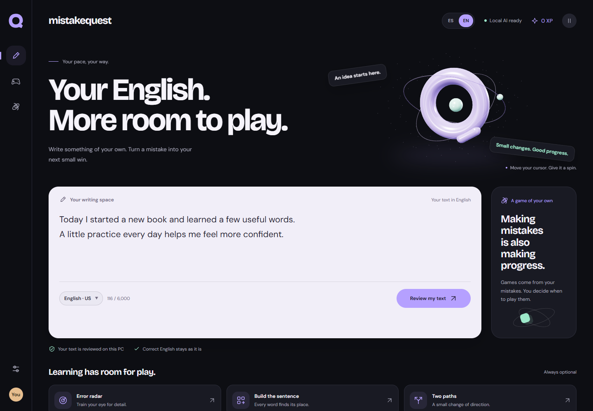
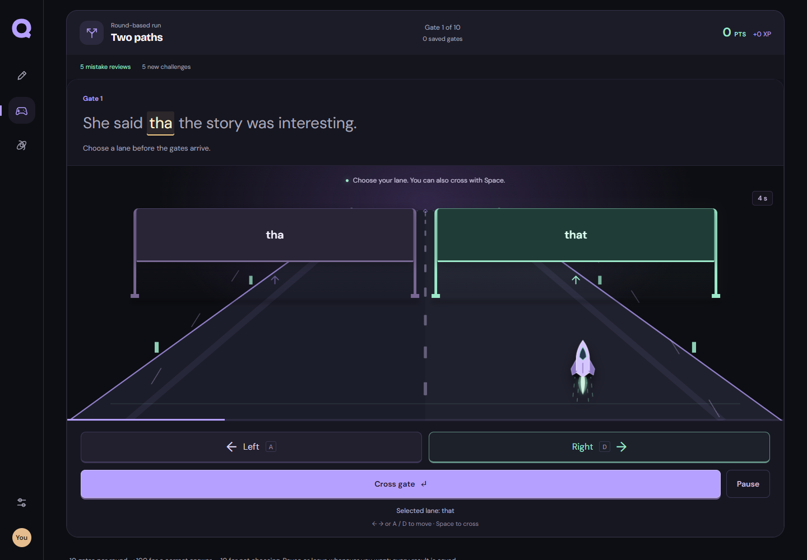
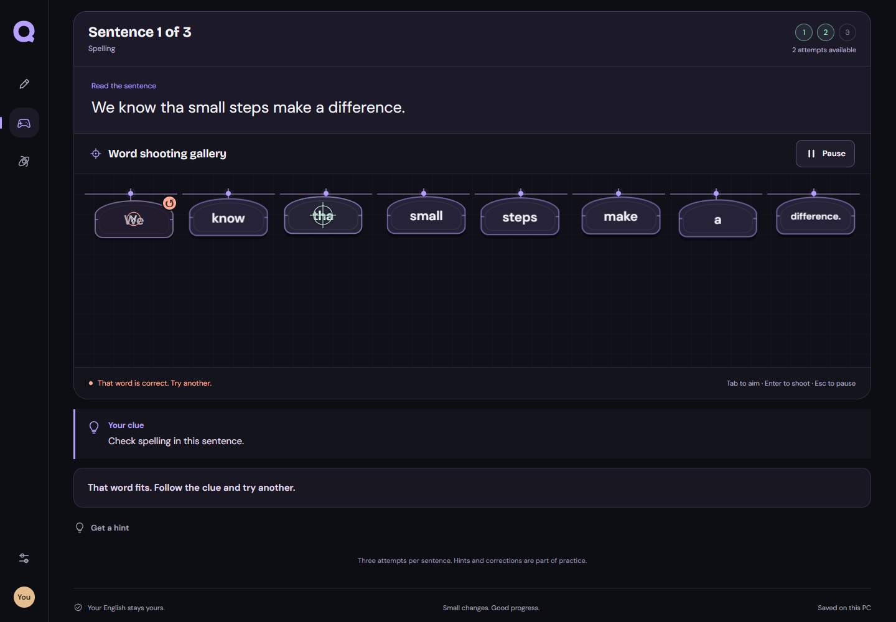
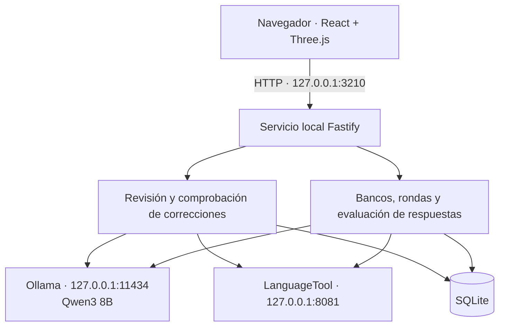

<p align="center">
  
</p>

<h1 align="center">MistakeQuest</h1>

<p align="center"><strong>Tu inglés. Tus errores. Otra forma de aprender.</strong></p>

<p align="center">
  Una app local para revisar tus textos en inglés y convertir sus correcciones en minijuegos opcionales.
</p>

<p align="center">
  
  
  
  
</p>

<p align="center">
  <a href="../README.md">English</a> ·
  <a href="#primeros-pasos">Primeros pasos</a> ·
  <a href="#seis-formas-de-practicar">Los juegos</a> ·
  <a href="#arquitectura">Arquitectura</a> ·
  <a href="#desarrollo-y-pruebas">Desarrollo</a>
</p>



*Las capturas de esta guía usan textos de ejemplo y progreso de demostración.*

MistakeQuest es una app con experiencia de escritorio que se abre en tu navegador. Escribe algo en inglés, revisa las correcciones sugeridas y practica un error concreto cuando quieras jugar. Ollama, Qwen3 8B, LanguageTool y SQLite funcionan en tu equipo; no necesitas cuenta ni clave de un servicio de IA en la nube.

La idea de partida es sencilla: **lo que está bien, se queda**. La revisión busca cambios pequeños y necesarios, conservando el significado y el vocabulario. Las mejoras de estilo se piden por separado y un texto sin errores detectados no genera ningún juego.

## Qué puedes hacer

- **Revisar tus propios textos.** Comprueba hasta 6.000 caracteres en inglés de EE. UU. o británico, con correcciones, explicaciones breves y avisos cuando hay dudas.
- **Aprender de una corrección concreta.** Elige entre seis juegos opcionales que usan tu error y ejemplos cortos adicionales comprobados antes de utilizarlos.
- **Volver a lo que necesita práctica.** Las rondas guardadas recuperan fallos, rotan ejemplos entre los formatos y conservan el progreso entre visitas.
- **Consultar tu historial de aprendizaje.** Sigue los errores de escritura recurrentes, revisiones, intentos de juego, partidas terminadas, puntos de carrera y XP. Los errores al escribir se cuentan aparte de los fallos al jugar.
- **Usar los controles en español o inglés.** Cambia el idioma de la interfaz sin perder el borrador ni la partida. La variante de inglés se configura por separado; los ejercicios siguen en inglés. Las explicaciones generadas usan actualmente el español y no se traducen automáticamente.
- **Elegir cuánto movimiento quieres.** La interfaz Órbita combina un editor claro, un entorno oscuro y una escena de Three.js. Puedes pausar el movimiento, usar la preferencia de movimiento reducido o ver un logo estático si WebGL no está disponible. Fuentes, iconos y recursos de la app se sirven localmente.

## Primeros pasos

Los scripts incluidos de instalación y arranque están preparados para **Windows x64**.

### Requisitos

| Requisito | Para qué sirve |
| --- | --- |
| Node.js **24 o superior**, con `npm` en `PATH` | Ejecuta el servicio y construye la interfaz; la base de datos usa el módulo SQLite integrado en Node. |
| Java **17 o superior**, con `java` en `PATH` | Ejecuta el servidor local de LanguageTool. |
| Internet durante la instalación inicial | Descarga las dependencias de npm, los motores y el modelo. |
| Disco y memoria para un modelo local de 8B | La descarga del modelo predeterminado ocupa aproximadamente 5 GB. Los motores, archivos de descarga y modelos instalados necesitan espacio adicional. |

La inferencia local requiere recursos considerables. Una GPU compatible puede reducir la espera; también es posible usar CPU, con mayor latencia. El proyecto no tiene un mínimo universal de RAM o GPU verificado. La primera revisión puede tardar más mientras se carga el modelo y los textos largos pueden requerir varias llamadas.

### Instalar y abrir

Abre PowerShell en la ubicación donde quieras guardar el proyecto:

```powershell
git clone https://github.com/yhonaMC/MistakeQuest.git
cd MistakeQuest
npm ci
npm run setup
& ".\Iniciar MistakeQuest.cmd"
```

Si descargaste el repositorio como ZIP, extráelo, abre PowerShell en esa carpeta y empieza por `npm ci`.

`npm run setup` ejecuta [Install-Engines.ps1](../scripts/Install-Engines.ps1). Instala **Ollama portable 0.40.4**, **LanguageTool 6.6** y **`qwen3:8b`** en `%LOCALAPPDATA%\MistakeQuest`. La primera descarga puede tardar. Si falla la descarga del modelo desde Ollama, el instalador puede importar el GGUF oficial de Qwen. Verifica con SHA-256 el archivo de Ollama y el modelo alternativo; comprueba el tamaño esperado del archivo de LanguageTool.

El lanzador inicia los motores en segundo plano, arranca el servicio local y abre **[http://127.0.0.1:3210](http://127.0.0.1:3210)**. Una vez instalado todo, las revisiones y los juegos pueden funcionar sin Internet. El modelo permanece instalado entre sesiones.

| Acceso de Windows | Acción |
| --- | --- |
| `Instalar motores.cmd` | Ejecuta la misma instalación de motores que `npm run setup`. |
| `Iniciar MistakeQuest.cmd` | Arranca los motores y la app, y abre el navegador. |
| `Detener MistakeQuest.cmd` | Detiene los procesos que estos scripts iniciaron y registraron. Conserva los datos y modelos. |

Cerrar la pestaña deja el servicio y los motores funcionando. Usa el acceso para detener la app cuando quieras apagarlos.

> **Actualizar la app:** el lanzador solo construye la interfaz si falta `dist/index.html`. Después de descargar cambios, detén la app, ejecuta `npm ci` y `npm run build`, y vuelve a iniciarla para servir la interfaz actualizada.

## De la escritura a la práctica

1. **Escribe o pega un texto.** Elige inglés US o UK y pulsa **Revisar mi texto**.
2. **Consulta el resultado.** El borrador sigue en el editor y las correcciones aparecen debajo. Editar el texto o cambiar la variante retira el resultado anterior.
3. **Elige un error para practicar.** Pulsa **Practicar este error** y escoge un juego. La práctica siempre es opcional.
4. **Construye un hábito útil.** Vuelve desde **Mi progreso**, continúa una ronda guardada o practica de nuevo un error recurrente.

La revisión combina una evaluación independiente de la IA con candidatos de LanguageTool, comprueba que los cambios coincidan con el original y filtra las preferencias de estilo opcionales. Los textos largos se revisan por fragmentos. Las correcciones compuestas independientes se separan en objetivos más pequeños; un cambio de orden se conserva completo para que mover un verbo no se convierta en ejercicios separados de borrarlo y añadirlo. Las palabras de alrededor que no cambian quedan fuera del objetivo. Los casos ambiguos pueden conservarse con un aviso de duda.

Cada ejemplo de práctica debe reproducir una corrección específica. LanguageTool o una revisión independiente de la IA lo comprueban antes de incorporarlo al banco persistente. Los juegos priorizan las frases menos vistas entre todos los formatos; si falla la generación adicional, siguen disponibles los ejemplos ya comprobados. Las correcciones históricas se revisan antes de practicar: si el fragmento ya estaba bien, deja de proponerse como error recurrente sin crear una partida ni XP ficticios.

Para variar los ejercicios de orden, la IA genera contextos breves y la app inserta la corrección confirmada. Cada frase construida sigue pasando por la comprobación gramatical y la revisión independiente de la IA. Los bancos antiguos que separaron un cambio de orden se regeneran al abrir ese error. Las rondas arcade excluyen esos ejemplos divididos y conservan las revisiones, los intentos, las recompensas y los puntos guardados.

**Sugerir una mejora** solo se ejecuta cuando lo pides. Puede concluir que no hace falta cambiar nada y nunca sustituye el borrador automáticamente.

La IA todavía puede omitir errores o proponer cambios incorrectos. Las comprobaciones reducen ese riesgo, pero no garantizan una revisión perfecta. Los tiempos verbales ambiguos se conservan cuando el contexto no justifica cambiarlos.

## Seis formas de practicar

| Juego | Qué haces |
| --- | --- |
| **Radar de errores** | Encuentra la palabra o el fragmento que necesita un cambio en una galería de palabras 2D. |
| **Taller de palabras** | Escribe el fragmento corregido o la frase completa correcta. |
| **Dos caminos** | Dirige un cohete hacia la puerta con la opción que encaja en la frase. |
| **Arma la frase** | Ordena fichas para construir una frase correcta. |
| **Conecta parejas** | Une cada frase con su corrección. |
| **¿Se queda o se corrige?** | Decide si una frase necesita un cambio y aprende también a reconocer el inglés válido. |

### Dos caminos: diez puertas y la opción de continuar



Cada ronda tiene **10 puertas**. Usa **← / →**, **A / D** o los controles en pantalla para elegir carril. Cruza con **Espacio**, el botón o al llegar a la puerta. El cohete mantiene el vuelo entre puertas y muestra un resumen al terminar la décima.

- Cada puerta permite normalmente **5 segundos**. Seis o más elecciones incorrectas o puertas omitidas dan **8 segundos** por puerta en la siguiente ronda.
- Un acierto suma **100 puntos de carrera**; una elección incorrecta da **0**; no elegir resta **10**.
- Las rondas posteriores recuperan los objetivos fallados, con otras frases cuando están disponibles, y los mezclan con retos nuevos. Por ejemplo, si hay contenido suficiente, **5 objetivos fallados + 5 retos nuevos** completan la siguiente ronda. Tres objetivos fallados pueden convertirse en tres repasos, dos repasos anteriores y cinco retos nuevos.
- Cuando se agota el contenido nuevo, la interfaz identifica los ejercicios restantes como **práctica verificada**.
- Se guarda cada resultado y el plan de la ronda. Puedes continuar una ronda pendiente desde **Mi progreso**. Pausar detiene el contador y el vuelo; desactivar el movimiento visual conserva el reto con tiempo.

### Radar de errores: tres frases y tres intentos por frase



Una sesión de Radar contiene **3 frases**, cada una con **3 intentos**. El primer y segundo blanco incorrecto revelan pistas progresivas. El tercero muestra la corrección y su explicación antes de pasar a la siguiente frase. Disparar al fondo o seleccionar un blanco descartado no consume otro intento.

Usa el ratón, toca una palabra o apunta con **Tab / flechas** y activa con **Enter**. Pausa para leer la corrección con calma. El resumen distingue los aciertos sin ayuda, los aciertos con pistas y las correcciones vistas al agotar los intentos.

La siguiente sesión prioriza los errores que agotaron sus intentos o necesitaron pistas y completa los espacios restantes con retos nuevos verificados cuando están disponibles. Los repasos usan otra frase sencilla cuando está disponible. Al retomar una sesión parcial se conservan los intentos restantes, las palabras descartadas y la pista actual.

### Recompensas de XP

| Partida resuelta | XP |
| --- | ---: |
| Sin ayuda | 20 |
| Con una pista | 10 |
| Después de ver la solución, donde está disponible | 5 |

Agotar un ejercicio de Radar o fallar u omitir una puerta no da XP. Repetir un ejercicio ya recompensado no vuelve a dar XP. El servidor evalúa y guarda los intentos y las recompensas; los puntos de carrera son una puntuación aparte.

## Datos y privacidad

MistakeQuest no usa cuentas ni una integración de IA en la nube. El navegador se comunica con la app local, que usa los motores locales. Los scripts fijan Ollama en loopback y la app solo escucha en `127.0.0.1`. Mantén estos servicios locales; el proyecto no está configurado como un servicio web público o multiusuario.

| Datos | Ubicación predeterminada |
| --- | --- |
| Historial y progreso SQLite | `%LOCALAPPDATA%\MistakeQuest\data\mistakequest.sqlite` |
| Archivos del modelo | `%LOCALAPPDATA%\MistakeQuest\models` |
| Motores portables | `%LOCALAPPDATA%\MistakeQuest\runtime` |
| Logs de arranque y motores | `%LOCALAPPDATA%\MistakeQuest\logs` |
| Descargas de instalación | `%LOCALAPPDATA%\MistakeQuest\downloads` |

- **Los textos completos no se guardan por defecto.** Se guardan las correcciones, explicaciones y frases de contexto necesarias para practicar, por lo que la base todavía puede contener escritura personal. Activa **Guardar mis textos completos** en Ajustes para conservar los textos completos de futuras revisiones.
- Revisar exactamente el mismo texto y variante en el mismo día del calendario local reutiliza una revisión terminada y evita duplicar estadísticas. Otro día puede crear una revisión nueva; los resultados dudosos se pueden reintentar.
- Exporta el historial como JSON desde Ajustes o Mi progreso. Ajustes permite borrar revisiones, errores, juegos y XP escribiendo **`BORRAR`**; los motores y modelos permanecen instalados.
- El idioma de la interfaz y las preferencias de movimiento se guardan en el navegador. El historial de aprendizaje vive en SQLite.
- Los logs del servicio de la app no registran el contenido de las revisiones. Trata la base de datos y las exportaciones como datos personales.

La instalación inicial contacta con servidores externos de paquetes y modelos. Los recursos, fuentes e iconos usados por la app son locales; la interfaz no necesita una CDN para funcionar.

## Arquitectura



Vite construye la interfaz en `dist/`; Fastify sirve esa salida y la API desde el mismo origen. Los servicios de revisión y práctica comparten los motores locales. SQLite conserva ajustes, revisiones, contexto de correcciones, bancos de ejemplos comprobados, juegos, planes de ronda, intentos y recompensas idempotentes.

```text
MistakeQuest/
├── service/           # API local, revisión, juegos y almacenamiento SQLite
│   ├── app.js         # Rutas y controles de solicitudes
│   ├── review.js      # Orquestación de revisión y validación de cambios
│   ├── games.js       # Verificación de ejemplos y evaluación de juegos
│   ├── practice-*.js  # Rotación de ejemplos y planes persistentes de ronda
│   └── store.js       # Persistencia SQLite y recompensas
├── web/               # Editor React, juegos, progreso, ajustes e idiomas
├── public/assets/     # Logo, iconos y fuentes servidas localmente
├── scripts/           # Instalación, arranque y apagado en Windows
├── tests/             # Pruebas unitarias, API, motores reales y navegador
└── docs/              # Documentación en español y capturas
```

### Configuración

El servicio lee directamente estas variables de entorno; no carga un archivo `.env`:

| Variable | Valor predeterminado | Función |
| --- | --- | --- |
| `MQ_PORT` | `3210` | Puerto HTTP local de la app. |
| `MQ_DATA_DIR` | `%LOCALAPPDATA%\MistakeQuest` en Windows | Raíz de la base de datos y los datos de la app. |

Para una instancia de desarrollo separada, construye la interfaz e inicia el servicio directamente:

```powershell
npm run build
$env:MQ_PORT = "3215"
$env:MQ_DATA_DIR = Join-Path $PWD ".runtime\development"
npm start
```

Los motores locales deben estar encendidos. El lanzador de Windows fija su propio `MQ_PORT=3210` y la carpeta de LocalAppData; usa `npm start` para valores personalizados. Las direcciones de los motores están fijadas en [service/config.js](../service/config.js). Ajustes permite seleccionar un modelo local instalado; la instalación y el lanzador incluidos esperan que `qwen3:8b` esté instalado.

### API local

| Método | Ruta | Función |
| --- | --- | --- |
| `GET` | `/api/health` | Disponibilidad de la app, base, motores y modelo. |
| `GET`, `PATCH` | `/api/settings` | Leer o actualizar `locale`, `model` y `saveTexts`. |
| `POST` | `/api/analyze` | Revisar `{ "text": "...", "locale": "en-US" }`. |
| `POST` | `/api/improvements` | Pedir una mejora opcional con los mismos datos de entrada. |
| `GET` | `/api/modes` | Listar los seis modos de juego. |
| `POST` | `/api/games` | Crear un juego con `issueId` y `mode`. |
| `GET` | `/api/games/:id` | Leer el estado público del juego. |
| `POST` | `/api/games/:id/attempt` | Enviar una respuesta y una `idempotencyKey`. |
| `POST` | `/api/games/:id/hint`, `/api/games/:id/reveal` | Pedir la ayuda disponible. |
| `POST` | `/api/practice-rounds` | Crear una ronda `choice` o `radar` con `issueId` e `idempotencyKey` UUID. |
| `GET` | `/api/practice-rounds/:id` | Leer una ronda guardada. |
| `POST` | `/api/practice-rounds/:id/next` | Avanzar tras completar `afterGameId`. |
| `GET` | `/api/progress`, `/api/export` | Leer el progreso o exportar los datos guardados. |
| `DELETE` | `/api/data` | Borrar datos de aprendizaje con `{ "confirmation": "BORRAR" }`. |

Las escrituras de la API requieren **`Content-Type: application/json`** y **`X-MistakeQuest: 1`**. Las solicitudes solo aceptan valores locales de `Host`; si se envía `Origin`, debe coincidir con el origen de la app. Son controles para el uso local desde el navegador, no autenticación remota.

Zod valida los datos de entrada. El texto admite **1–6.000 caracteres**, las variantes son **`en-US` / `en-GB`** y el límite del cuerpo HTTP es de **65.536 bytes**. Las respuestas de texto tienen un máximo de **600 caracteres** y las claves idempotentes de intentos admiten **8–100 caracteres**. Consulta [service/schemas.js](../service/schemas.js) para los campos de cada modo y [service/app.js](../service/app.js) para las rutas completas.

## Desarrollo y pruebas

```powershell
npm ci
npm run build
npm test
```

No hay un script npm `dev`. `npm start` ejecuta el servicio con la compilación actual de `dist/`. Para recarga automática de la interfaz, ejecuta `npx vite` en otra terminal mientras el servicio usa el puerto `3210`; Vite escucha en loopback, puerto `5173`, y redirige `/api` al servicio.

| Comando | Cobertura y requisitos |
| --- | --- |
| `npm test` | Pruebas unitarias y de API de Node: validación de revisiones, reglas de juegos, persistencia y recompensas. No necesita los motores reales. |
| `npm run test:live` | Revisiones y juegos con Ollama, Qwen3 8B y LanguageTool reales. Enciende antes los motores. |
| `npm run test:live:arcade` | Parte de una base vacía, revisa el texto y genera ejemplos con los motores locales reales; después juega diez puertas y una sesión de Radar guiado. Verifica el regreso de errores, el guardado tras reiniciar y la exportación. Requiere compilación actual, motores y Microsoft Edge; elige su propio puerto local. |
| `npm run test:live:grammar` | Repite el flujo de navegador con motores reales y un texto más largo. Ambos juegos completos deben usar correcciones reales de concordancia, forma verbal y orden de palabras, con frases nuevas generadas. Comprueba que el inglés sencillo correcto se conserve y que el progreso sobreviva al reinicio. Requiere lo mismo que `test:live:arcade`. |
| `npm run test:e2e` | Flujo con motores reales desde la revisión hasta los seis juegos, persistencia tras reiniciar y diseño móvil. Requiere compilación actual, motores, Microsoft Edge instalado y puerto `3211` libre. |
| `npm run test:arcade` | Los seis formatos, ES/EN, variedad, vuelo continuo, rondas guardadas, puntos e intentos de Radar. Usa datos aislados y motores simulados; requiere compilación actual y Microsoft Edge. |
| `node tests/orbit-ui.mjs` | Render 3D, controles persistentes de movimiento, selección por teclado, tamaños móviles y respaldo sin WebGL. Simula la disponibilidad de motores; requiere compilación, Microsoft Edge y puerto `3212` libre. |
| `node tests/writing-layout-browser.mjs` | Tamaño, foco y selección del editor durante la revisión en escritorio y móvil. Requiere Microsoft Edge. |
| `node tests/practice-status-browser.mjs` | Retirada de falsos positivos históricos mediante la API real, una base aislada y sin llamadas a la IA. Requiere compilación, Microsoft Edge y puerto `3213` libre. |

Las pruebas de navegador seleccionan el canal de **Microsoft Edge** instalado mediante Playwright (`msedge`). Las comprobaciones con el modelo real pueden tardar bastante más que las de datos preparados y variar según su salida. La evidencia del navegador se guarda en la carpeta ignorada `test-results/`. Estas suites usan bases aisladas en lugar del historial habitual de aprendizaje.

`npm run test:arcade` también comprueba el límite de diez puertas, los repasos de respuestas incorrectas y puertas omitidas, el regreso de errores agotados o resueltos con pistas en Radar, la recuperación desde Mi progreso y el componente de Radar guiado. La suite unitaria cierra y vuelve a abrir archivos SQLite reales para verificar pistas, intentos, colas de repaso y reintentos sin duplicar XP ni puntos.

Para comprobar el flujo completo desde la IA hasta los juegos, usa `npm run test:live:arcade`. No prepara correcciones ni bancos de ejemplos de antemano y no sustituye las respuestas de los motores por datos simulados. El informe guarda el texto de prueba, las correcciones reales, las llamadas a los motores, los resultados de los juegos y el progreso en `test-results/live-arcade-*`.

Usa `npm run test:live:grammar` para comprobar gramática y orden de palabras en un texto más largo. Verifica el párrafo corregido completo, las posiciones de origen, los cambios de orden completos, la variedad de frases generadas, los errores gramaticales jugados en ambos modos, el regreso de fallos, una sesión parcial de Radar y el progreso guardado y exportado exacto tras volver a abrir la app y SQLite. Los informes de `test-results/live-arcade-grammar-*` también incluyen las respuestas de generación para diagnosticar ejemplos rechazados. Los textos son ficticios y la prueba crea su propia base de datos.

También hay comprobaciones específicas: `node tests/radar-arcade-browser.mjs`, `node tests/runner-arcade-browser.mjs` y `node tests/learner-paragraph.mjs --all`. La del párrafo usa motores reales y escribe en `test-results/`; crea esa carpeta antes si todavía no existe.

## Solución de problemas

| Síntoma | Qué comprobar |
| --- | --- |
| No se encuentra `node`, `npm` o `java` | Instala el runtime requerido, comprueba su versión y vuelve a abrir la terminal para actualizar `PATH`. |
| Falta un motor o modelo | Ejecuta `npm run setup` y vuelve a iniciar la app. Ajustes muestra la disponibilidad de Ollama, LanguageTool y el modelo seleccionado. |
| La primera revisión tarda mucho | Espera a que cargue el modelo. La CPU y las revisiones por fragmentos pueden ser lentas. Consulta los logs si falla la solicitud. |
| El modelo está ocupado | Espera a que termine la petición activa. Las llamadas al modelo se ejecutan en serie y el servicio limita el trabajo pendiente. |
| La interfaz muestra código antiguo | Detén la app, ejecuta `npm run build`, vuelve a iniciarla y recarga el navegador. El lanzador no reconstruye un `dist/` existente. |
| La app o una prueba no puede usar un puerto | Comprueba si otro proceso lo ocupa. Los puertos habituales son `3210`, `11434` y `8081`; algunas pruebas reservan los puertos separados indicados arriba. |
| No se puede verificar una revisión o un ejemplo nuevo | Comprueba los motores y reintenta. El borrador se conserva; los ejemplos comprobados y el progreso guardado siguen disponibles. |
| No se abre el navegador de una prueba | Instala Microsoft Edge; las suites solicitan expresamente el canal `msedge` de Playwright. |

Los detalles del arranque están en `%LOCALAPPDATA%\MistakeQuest\logs`, incluidos `app.err.log`, `ollama.err.log` y `languagetool.err.log`. **Comprobar conexión** en Ajustes y [`/api/health`](http://127.0.0.1:3210/api/health) ayudan a distinguir un problema de la app de un motor no disponible.

Creado con [React](https://react.dev/), [Vite](https://vite.dev/), [Fastify](https://fastify.dev/), [Three.js](https://threejs.org/), [Ollama](https://docs.ollama.com/windows), [Qwen3 8B](https://ollama.com/library/qwen3:8b) y [LanguageTool](https://dev.languagetool.org/http-server). Los avisos de licencia de las fuentes están incluidos en [public/assets](../public/assets).
